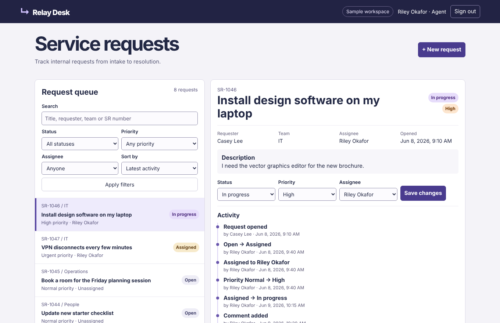
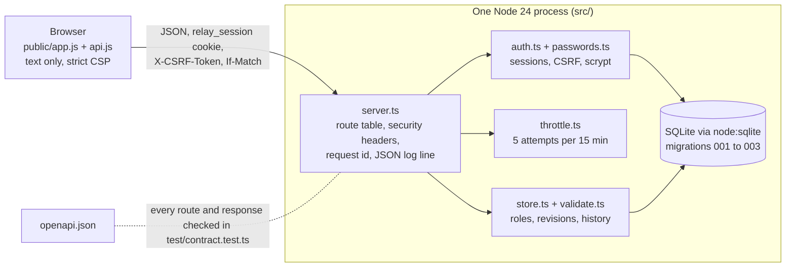

# Service Request Tracker

[](https://github.com/muhammmmadziam1234-eng/service-request-tracker/actions/workflows/test.yml)

Relay Desk is an internal service desk. People open requests (IT, Facilities, People, Operations); agents prioritise, assign, comment and move them through a workflow; every change lands in a history that says who did what. It is a Node 24 server with no runtime dependencies (TypeScript run directly by Node, SQLite through `node:sqlite`) and a plain-JavaScript browser interface. It started as a 270-line demo; what was added are the parts a real internal tool needs and demos usually skip: hand-built sign-in and roles, safe database migrations, an API contract that the tests enforce, and browser tests including accessibility checks. All data is fictional, and the three sign-in accounts are **demo-only** (see [Run locally](#run-locally)).



## What it demonstrates

- **Schema changes that cannot lose data.** Numbered SQL migrations run at start, each in its own transaction with the `PRAGMA user_version` bump. A test builds a genuine version-1 database with a verbatim copy of the old store, upgrades it, and compares every row, revision and history entry. [`src/migrate.ts`](src/migrate.ts), [`migrations/`](migrations), [`test/migrate.test.ts`](test/migrate.test.ts)
- **Authentication written on Node's crypto, and tested.** scrypt hashes, constant-time comparison, a dummy comparison for unknown users, server-side sessions stored only as a SHA-256 with sliding and absolute expiry, a CSRF token on every write, and a login throttle driven by an injectable clock. [`src/auth.ts`](src/auth.ts), [`src/passwords.ts`](src/passwords.ts), [`src/throttle.ts`](src/throttle.ts), [`test/auth.test.ts`](test/auth.test.ts)
- **Roles decided in one place, checked cell by cell.** A requester reaches only their own requests (anyone else's is a 404); agents and admins work the queue. One table-driven test runs 15 actions as requester, agent, admin and anonymous (60 cells). Edits use ETag / If-Match: a stale write is a 412 and leaves no history. [`src/store.ts`](src/store.ts), [`test/roles.test.ts`](test/roles.test.ts), [`test/domain.test.ts`](test/domain.test.ts)
- **An API contract the server is held to.** [`openapi.json`](openapi.json) (OpenAPI 3.1) describes all 18 operations; contract tests call each one, validate the real responses against the documented schemas with Ajv, and fail if the server has a route the document lacks. [`test/contract.test.ts`](test/contract.test.ts)
- **A browser interface tested like a user would use it.** Twelve Playwright tests, including two browsers editing one request and zero axe-core violations on the sign-in page, the queue with a request open (as agent and as requester) and the create dialog; the queue and dialog are checked again at 360 px. The page runs under a strict CSP and renders server values as text only. [`e2e/ui.test.ts`](e2e/ui.test.ts), [`public/app.js`](public/app.js), [`test/static.test.ts`](test/static.test.ts)

## Architecture



| Path | What is in it |
| --- | --- |
| `src/` | The server, in TypeScript that Node runs as it is (963 lines in 18 files). `main.ts` reads the environment and handles signals, `run.ts` starts and stops, `server.ts` holds the route table. |
| `migrations/` | `001` is exactly the original schema; `002` adds accounts and sessions; `003` adds priority, assignee, owner, comments and the actor in the history. |
| `public/` | The interface: plain JavaScript modules checked by `tsc` (`// @ts-check` and JSDoc), one stylesheet, one icon. |
| `test/`, `e2e/` | `node:test` suites (unit, HTTP integration, contract) and the browser tests. |
| `scripts/` | The coverage gate, the screenshot, and the account-creation command. |
| `docs/evidence/` | Saved output of the commands quoted below. |

## Key decisions and trade-offs

- **scrypt, from `node:crypto`.** No dependency to audit, and it is memory-hard. The cost (N=16384, r=8, p=1, 16 MiB per hash; 16-byte salt, 64-byte key) is a floor that keeps sign-in fast in tests; a real deployment should raise it. Each hash records its own cost and a successful sign-in upgrades an older hash, so raising the constant in [`src/passwords.ts`](src/passwords.ts) locks nobody out.
- **Server-side sessions, not JWTs.** Signing out really ends the session, the token never reaches script (`HttpOnly`), and expiry is enforced by the server. The price is one indexed SQLite read per request (and a write at most once a minute to slide the expiry). Only the SHA-256 of the token is stored, so a copy of the database cannot be replayed.
- **SQLite.** One file, real transactions, WAL, nothing to run next to it. The price: one writer and one process. Moving to PostgreSQL would touch `src/db.ts`, `src/store.ts`, `src/users.ts`, `src/auth.ts`, `src/seed.ts` and the migrations.
- **No framework.** 18 operations do not need one, and a plain route table (`{method, path, handler}` data) is what lets the tests compare the server with `openapi.json`. The price is hand-written body parsing and routing; those parts have their own tests (413, 415, 400, 405).
- **TypeScript by type stripping.** Node 24 runs `.ts` files directly, so there is no build step and the Docker image holds the source as it is. The price: only erasable syntax (no `enum`, `namespace` or parameter properties), `.ts` import extensions, and types that are checked by `npm run typecheck` rather than at run time.
- **Strict inputs.** Unknown fields are refused rather than ignored (a typo cannot silently do nothing); a field that already has the requested value is not a change (no revision bump, no history entry); one `PATCH` can change status, priority and assignee together with a single revision bump.

## Security model

| Threat | Defence | Proven by |
| --- | --- | --- |
| Guessing passwords | scrypt; 5 sign-in attempts per username and address in 15 minutes, counted as each one starts so that parallel requests cannot get around the limit (a successful sign-in clears the count), then `429` with `Retry-After`, and a locked account refuses even the right password | [`test/throttle.test.ts`](test/throttle.test.ts), [`test/auth.test.ts`](test/auth.test.ts) |
| Learning which usernames exist | An unknown username is verified against a dummy hash and gets the same `401` text as a wrong password (timing itself is not measured by a test) | [`test/auth.test.ts`](test/auth.test.ts) |
| A copied database | Passwords are scrypt hashes; session tokens are stored as SHA-256 only | [`test/auth.test.ts`](test/auth.test.ts) |
| Script injection | Strict CSP (`default-src 'self'`, no inline script or style), server values rendered with `textContent` only, `HttpOnly` cookie | [`test/static.test.ts`](test/static.test.ts), [`e2e/ui.test.ts`](e2e/ui.test.ts) |
| Cross-site requests | `SameSite=Strict` cookie, plus a per-session `X-CSRF-Token` on every write (constant-time compare); sign-in needs a JSON body, which a cross-site form cannot send | [`test/auth.test.ts`](test/auth.test.ts), [`e2e/ui.test.ts`](e2e/ui.test.ts) |
| Reusing an old session | Sign-out deletes the row; 8 hours idle or 24 hours in total ends it; expired rows are removed when used and swept at the next sign-in | [`test/auth.test.ts`](test/auth.test.ts) |
| Reading or changing someone else's requests | Visibility is decided in `src/store.ts`: requesters get `404` for requests that are not theirs and `403` for actions that are not theirs | [`test/roles.test.ts`](test/roles.test.ts) |
| Lost updates | `ETag` / `If-Match`: `428` without it, `412` when stale | [`test/api.test.ts`](test/api.test.ts), [`e2e/ui.test.ts`](e2e/ui.test.ts) |
| SQL injection | Prepared statements throughout; the one assembled clause (`ORDER BY`) comes from a fixed list | [`src/store.ts`](src/store.ts) |
| Oversized, malformed or slow requests | 8 KB body limit (`413`), JSON objects only (`415`/`400`), control characters rejected, unparsable requests answered in the standard shape, header and request timeouts of 10 s and 15 s (set in `src/server.ts`, not covered by a test) | [`test/contract.test.ts`](test/contract.test.ts), [`test/headers.test.ts`](test/headers.test.ts) |
| Secrets in logs | One JSON line per request: time, id, method, path (parameter names, never values), status, duration, user id. No cookies, bodies, tokens or passwords | [`test/logging.test.ts`](test/logging.test.ts) |

**Out of scope**, and left to the deployment: TLS and HSTS (terminate HTTPS in a reverse proxy and set `COOKIE_SECURE=1`), network-level denial of service, a throttle shared between processes, backups, encryption of the database file, multi-factor sign-in, password reset, and anything that needs email.

## API

The contract is [`openapi.json`](openapi.json), also served at `GET /openapi.json`. Errors always look like `{"error":{"code":"...","message":"..."}}` with one of 16 stable codes. Every response carries `X-Request-Id` and the security headers.

| Operation | Who | Notes |
| --- | --- | --- |
| `POST /api/login`, `POST /api/logout`, `GET /api/session` | anyone / signed in | sign-in sets the cookie and returns the CSRF token |
| `GET /api/requests` | signed in | `{items,total,limit,offset}`; `limit` 1-100 (default 20), `offset`, `sort` = updated, created or priority, `order`, filters `status`, `priority`, `assignee` (an id or `none`), `q` |
| `POST /api/requests` | signed in | opens a request as the signed-in user |
| `GET /api/requests/{id}` | owner, agent, admin | with history, comments and `ETag` |
| `PATCH /api/requests/{id}` | agent, admin | `status`, `priority`, `assignee`; needs `If-Match` |
| `POST /api/requests/{id}/comments` | owner, agent, admin | does not need or change the revision |
| `GET /api/assignees` / `GET /api/users` | agent, admin / admin | who can be assigned / all accounts (no hashes) |
| `GET /healthz`, `GET /readyz` | anyone | liveness; readiness (503 if the database does not answer) |

| Role | Opens requests | Sees | Comments | Changes status, priority, assignee | Lists accounts |
| --- | --- | --- | --- | --- | --- |
| requester | yes | their own | on their own | no (403) | no (403) |
| agent | yes | all | on any | yes | no (403) |
| admin | yes | all | on any | yes | yes |

Three calls against a running server (real output, including the failures, in [`docs/evidence/curl-session.txt`](docs/evidence/curl-session.txt)):

```sh
# 1. Sign in. The cookie goes to jar.txt; the body holds this session's CSRF token.
curl -s -c jar.txt -H "Content-Type: application/json" \
  -d '{"username":"riley","password":"relay-demo-2026"}' http://127.0.0.1:4180/api/login
CSRF=<the csrf_token from the response>

# 2. Read (the cookie is enough).
curl -s -b jar.txt "http://127.0.0.1:4180/api/requests?status=Open&sort=priority&limit=2"

# 3. Write: cookie, CSRF header and the revision you read. Without X-CSRF-Token this is 403 csrf_failed;
#    with an old If-Match it is 412 precondition_failed.
curl -si -b jar.txt -X PATCH http://127.0.0.1:4180/api/requests/1045 \
  -H "Content-Type: application/json" -H "X-CSRF-Token: $CSRF" -H 'If-Match: "1"' \
  -d '{"priority":"High","assignee":2}'
```

## Run locally

Node.js 24 or later. The server has no runtime dependencies, so `npm start` needs no install.

```sh
npm start        # http://127.0.0.1:4180
```

The first start creates `data/requests.sqlite` with fictional sample requests and these accounts:

> **Demo accounts: demo only.** `casey` (requester), `riley` (agent) and `morgan` (admin) share the published password `relay-demo-2026`. Anyone who reads this page knows it. Use them on your own machine to look around, never on a server other people can reach. Real use needs real accounts: start with `SEED_DEMO=0` and create them with the command below.

```sh
SEED_DEMO=0 npm start
NEW_USER_PASSWORD='a passphrase of 12 or more characters' npm run user:create -- alex admin "Alex Admin"
```

The password is read from the environment, never from the arguments, and is stored only as a scrypt hash. Settings come from the environment and are validated at start; every problem is listed and the server does not start:

| Variable | Default | Meaning |
| --- | --- | --- |
| `PORT` | `4180` | 0 to 65535 (0 picks a free port) |
| `HOST` | `127.0.0.1` | bind address; localhost unless you say otherwise |
| `REQUEST_DB` | `data/requests.sqlite` | the SQLite file (`:memory:` for experiments) |
| `COOKIE_SECURE` | `0` | `1` adds `Secure` to the session cookie; set it when served over HTTPS |
| `LOG` | `on` | `off` silences the request log |
| `SEED_DEMO` | `1` (`0` in the Docker image) | `0` skips the demo accounts and sample requests |

Binding beyond localhost with the demo accounts or without `COOKIE_SECURE=1` prints a warning at start. `SIGTERM` and `SIGINT` stop accepting connections, close idle ones, give running requests up to 5 seconds, close the database and exit 0 (the test sends `SIGTERM`; `SIGINT` uses the same handler).

## Run in Docker

```sh
docker compose up --build      # http://127.0.0.1:4180, data in the relay-data volume
```

The image is `node:24-slim` plus the source, runs as the unprivileged `node` user, keeps the database on the `/data` volume and has a `HEALTHCHECK` that fetches `/healthz`. The compose file publishes the port on loopback only and turns the demo accounts on. **The image on its own does not seed them** (`SEED_DEMO=0`), because it listens on every interface; a plain `docker run` therefore starts with no accounts, and `docker run -e SEED_DEMO=1 …` is for a machine only you can reach.

The `docker` job in [`.github/workflows/test.yml`](.github/workflows/test.yml) builds the image, starts it, waits for `/healthz` to answer 200, then checks that `/readyz` answers 200 and that `/api/requests` answers 401 without a session. It has passed on GitHub's runners; there was no Docker daemon in the environment where the code was written, so that job is the only place the image has been built.

## Quality gates

```sh
npm ci                  # development tools only: TypeScript, Playwright core, axe-core, Ajv
npm run typecheck       # tsc: strict, noUncheckedIndexedAccess, erasableSyntaxOnly; src, tests, scripts and public/ (checkJs)
npm test                # 156 tests
npm run coverage        # the same tests with coverage; fails below 85% of code lines in src/
CHROME_PATH=/path/to/chrome npm run test:e2e    # 12 browser tests
npm audit --omit=dev    # production dependencies
```

| Check | Result | Recorded in |
| --- | --- | --- |
| Tests | 156 passed: 22 unit, 113 integration (HTTP and process), 21 contract | [`docs/evidence/coverage.txt`](docs/evidence/coverage.txt) |
| Coverage of `src/` | 99.6% of code lines (850 of 853), 95.0% of branches, 98.1% of functions; gate 85% | [`docs/evidence/coverage.txt`](docs/evidence/coverage.txt) |
| Browser tests | 12 passed, Chromium | [`docs/evidence/e2e.txt`](docs/evidence/e2e.txt) |
| `npm audit --omit=dev` | 0 vulnerabilities (there are no runtime dependencies) | [`docs/evidence/audit.txt`](docs/evidence/audit.txt) |

Node's coverage reporter counts blank and comment lines as covered lines (99.7% raw); the gate leaves them out, and the evidence file shows both. The three uncovered lines are error paths in `src/run.ts`. CI (`.github/workflows/test.yml`, workflow `Tests`) runs the first four in separate `check` and `e2e` jobs, plus the `docker` job. To retake the screenshot: `CHROME_PATH=/path/to/chrome node scripts/capture-preview.ts`.

## Limits and next steps

- **Not run here:** the Docker build and the three CI jobs (see above); I had no Docker and the CI workflow only runs on GitHub.
- **Browsers:** only Chromium is tested, at 1280 and 360 px wide; Firefox, Safari and real phones are not.
- **Accounts:** no sign-up, password change or reset, and no account screen; accounts are made with the command above and listed with `GET /api/users`. Requesters cannot reopen their own requests, and nobody can open a request on someone else's behalf.
- **Throttle:** counted per username and client address, in memory, per process. Behind a reverse proxy every client shares the proxy's address (`X-Forwarded-For` is deliberately ignored), and a flood of sign-ins with many different usernames is not limited at all; each costs one scrypt run on the thread pool.
- **Data:** comments are not paginated, edited or deleted; search is a substring match that is case-insensitive for ASCII only; requests written before accounts existed have no owner, so only agents and admins see them.
- **Platform:** `node:sqlite` is a recent Node module whose API may still change between major versions; SQLite allows a single writer, so this is one process on one machine.
- **Not done:** an audit-log endpoint for admins and a `/metrics` endpoint.

Next steps I would take for a real deployment: put it behind a reverse proxy with TLS and a shared-address-aware throttle, add the audit-log endpoint, and move the store to PostgreSQL if more than one instance is needed.

All people, requests and addresses in this project are fictional.

© 2026 muhammmmadziam1234-eng. All rights reserved.
