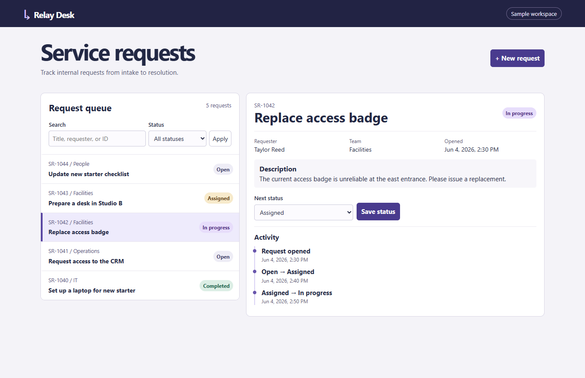

# Service Request Tracker

Relay Desk is a full-stack demo for logging an internal service request, moving it through a workflow, and reviewing its activity.

## Run locally

Requires Node.js 24 or later. There are no packages to install.

~~~sh
npm start
npm test
~~~

Open http://127.0.0.1:4180. Create a request with fictional details, move it from **Open** to **Assigned**, then inspect the activity history. Restart the server to see that the changes are saved.

## Implementation

- Browser interface with search, status filtering, a request form, and an activity timeline.
- Node.js HTTP API: GET and POST at /api/requests; GET and PATCH at /api/requests/:id.
- SQLite stores requests and activity. A status change and its activity entry are written in the same transaction. Each request carries a revision: GET returns it as an ETag, and PATCH requires the matching If-Match header. If two tabs edit the same record, the second write receives 412 and the UI loads the current version.
- Tests exercise the API, simulate stale writes from two clients, and reopen a saved database to check persistence.

The demo creates data/requests.sqlite and adds fictional records on first start. Set REQUEST_DB to use a different database file or PORT to change the port. By default the server binds to localhost. The sample has no account system and is intended for local evaluation with fictional data.
